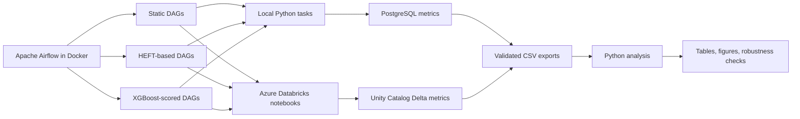
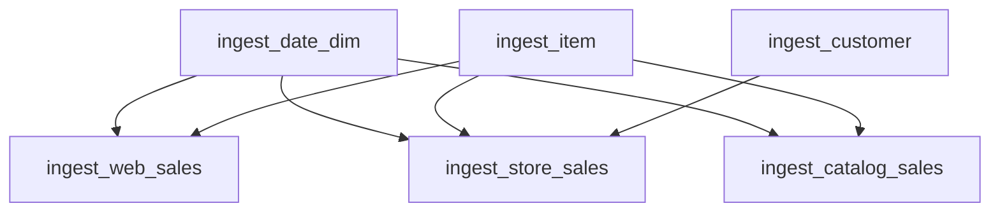
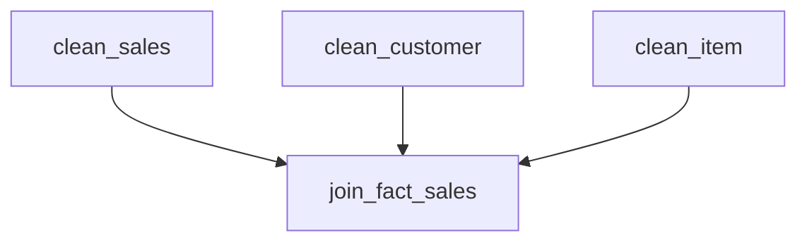
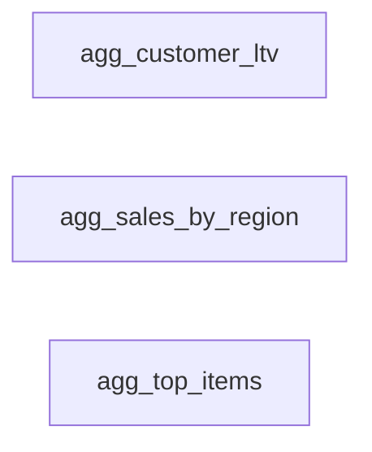

# Comparative Analysis of Static, Heuristic, and ML-Driven Task Scheduling in Medallion Lakehouse ETL Pipelines

Master’s thesis implementation and experimental archive for comparing three Apache Airflow task-priority strategies across Bronze, Silver, and Gold Medallion Lakehouse ETL layers:

- **Static task prioritisation**
- **HEFT-based upward-rank prioritisation**
- **Offline XGBoost task-priority scoring**

The project combines a controlled local Apache Airflow benchmark with validation on Azure Databricks. It examines how DAG topology, dependency-release timing, concurrent resource interference, and permitted task concurrency affect layer-level completion time.

> **Main finding:** no scheduling strategy wins universally. The preferred policy depends on the structure of the ETL layer and the execution environment.

## Thesis information

| Field | Value |
|---|---|
| Author | Gurusaran Sivakumar |
| University | RWTH Aachen University |
| Programme | M.Sc. Data Analytics and Decision Science |
| Chair | Chair of Data and Business Analytics |
| Supervisor | Prof. Dr. Müller |
| Submission date | 28 October 2026 |
| Primary objective | Minimise the layer processing-window makespan |

## Project overview

When more Airflow tasks are ready than the available execution capacity permits, the scheduler must decide which tasks receive the available slots. A task-level decision can affect the completion time of the full layer in several ways:

- A short task may release several downstream tasks.
- A long task may lie on a critical remaining path.
- Two independently ready tasks may interfere when they share the same Spark cluster.
- Higher concurrency may reduce wall-clock completion time even when individual tasks become slower.

This repository evaluates these effects separately in the three Medallion layers.

### Bronze

The Bronze layer ingests six selected source tables. Its main scheduling mechanism is **dependency release**. Completing high-fan-out root tasks early can create downstream parallelism sooner.

### Silver

The Silver layer cleans and integrates the data. Its main structural feature is a **convergence barrier**: the final fact join must wait for all required cleaning tasks. This limits the scheduling freedom available to the priority strategies.

### Gold

The Gold layer contains independent aggregation tasks. Its performance depends on **overlap, pair compatibility, resource interference, and concurrency** because several notebooks may compete for the same Spark resources.

## Research questions

1. How does HEFT-based upward-rank task prioritisation compare with Static scheduling across the Bronze, Silver, and Gold layers?
2. How does XGBoost-based task-priority scoring compare with Static and HEFT-based prioritisation across the three layers?
3. How do dependency-release timing and concurrent resource interference mediate the relationship between task-priority decisions and layer-level makespan?
4. To what extent do local scheduling results transfer to Azure Databricks execution, and how sensitive are the results to permitted task concurrency?

Cloud cost is treated as supplementary operational evidence rather than a primary research question.

## Scheduling strategies

### Static prioritisation

A deterministic, manually defined priority order is used as the baseline.

**Advantages**

- Transparent and reproducible
- Low operational complexity
- No training data required
- Easy to audit and modify

A carefully designed Static order is a strong baseline because it can encode valid domain knowledge, such as prioritising tasks that release important downstream work.

### HEFT-based upward-rank prioritisation

The implementation calculates HEFT-style upward ranks and maps them to Airflow `priority_weight` values.

This is **not full classical HEFT**. It does not perform heterogeneous processor selection or task-to-processor assignment. The implementation should be described as:

- **HEFT-based upward-rank prioritisation**, or
- **HEFT-inspired Airflow priority heuristic**

The method emphasises estimated computation cost and remaining successor paths. It can be effective when path criticality represents the main bottleneck, but it may under-prioritise short tasks with high immediate release value.

### Offline XGBoost task-priority scorer

The XGBoost model predicts a task-level priority score from engineered task, graph, and historical features. Example feature groups include:

- Estimated and historical duration
- Layer and task identity
- Upstream and downstream counts
- HEFT rank
- Data scale
- Historical scheduling delay
- Fan-out and short-unlock indicators

The model is trained offline. It is **not an adaptive, online, or globally optimal scheduler**. It does not directly optimise the complete DAG and does not model every pairwise concurrency effect.

Confirmed implementation paths include:

```text
airflow/plugins/heft_scheduler.py
airflow/plugins/xgb_scheduler.py
ml/training/train_xgboost.py
```

## Experimental architecture



Airflow determines which ready task receives an execution slot. The local benchmark uses controlled Python task durations, while Azure validation uses parameterised Spark notebooks and Delta outputs.

## Dataset

The cloud experiment used six selected tables from the Databricks built-in `samples.tpcds_sf1` dataset:

- `date_dim`
- `item`
- `customer`
- `web_sales`
- `store_sales`
- `catalog_sales`

The selected tables contained:

- **5,229,704 records**
- **273.93 MB** of reported compressed source data

Although SF1 denotes an approximately 1 GB complete benchmark dataset, this project processes only the listed subset. The study is therefore TPC-DS-derived and does not claim execution of the full TPC-DS benchmark.

## Pipeline tasks

### Bronze layer



### Silver layer



### Gold layer



The Gold tasks have no precedence edges. Their ordering affects which tasks share the cluster in the first execution wave.

## Experiment inventory

| Experimental phase | Runs | Task observations |
|---|---:|---:|
| Local strategy benchmark | 90 | 390 |
| Official Azure strategy benchmark | 45 | 195 |
| Bronze dependency-unlocking study | 10 | 60 |
| Gold opening-pair study | 15 | 45 |
| Gold concurrency-sensitivity study | 15 | 45 |
| **Total** | **175** | **735** |

The official Azure benchmark is analysed separately from the exploratory mechanism studies.

## Execution environments

### Local benchmark

- Windows 11
- Apache Airflow 2.9.0
- Docker Compose
- LocalExecutor
- PostgreSQL metadata and experiment database
- Databricks provider 7.0.0
- NetworkX 3.6.1
- Custom image: `medallion-airflow:2.9.0-databricks`
- `max_active_tasks = 2`
- 10 repetitions per layer-strategy combination

The local tasks use controlled stochastic durations. This environment isolates precedence, priority, queueing, and limited Airflow capacity. It does not reproduce Spark internals or real cloud contention.

### Azure Databricks validation

- Azure Databricks Premium trial workspace
- Region: UAE North
- Databricks Runtime 17.3 LTS
- Spark 4.0
- Scala 2.13
- Single-node `Standard_D4ds_v4`
- 4 cores and 16 GB memory
- Photon disabled
- 10-minute auto-termination
- `max_active_tasks = 2` in the official benchmark
- 5 repetitions per layer-strategy combination

The Azure workspace and associated thesis resources were deleted after the experimental archive was completed. Reproducing the cloud phase requires a new Databricks workspace, cluster, credentials, Unity Catalog objects, and Airflow configuration.

## Metrics

The primary metric is the **layer processing window**:

```text
maximum task end time - minimum task start time
```

For Azure, this is also described as the **Databricks task-processing window**.

This metric is different from:

- Total Airflow DAG runtime
- Individual task duration
- Aggregate task-seconds
- Cloud billing cost

A schedule can reduce the processing window while increasing aggregate task-seconds because concurrently running tasks overlap.

## Main benchmark results

### Local mean processing window

| Layer | Static | HEFT-based | XGBoost |
|---|---:|---:|---:|
| Bronze | **11.097 s** | 12.265 s | 11.536 s |
| Silver | **16.455 s** | 16.558 s | 16.537 s |
| Gold | 15.062 s | **13.338 s** | 13.771 s |

Local interpretation:

- **Bronze:** Static was fastest; HEFT delayed an important high-unlock root.
- **Silver:** all strategies were practically equivalent.
- **Gold:** HEFT and XGBoost were faster than Static in the controlled environment.

Local inferential results should be interpreted with caution because the Wilcoxon signed-rank procedure relies on a defensible pairing structure. The final analysis supplements p-values with descriptive distributions and effect evidence.

### Official Azure mean processing window

| Layer | Static | HEFT-based | XGBoost |
|---|---:|---:|---:|
| Bronze | 128.545 s | 141.546 s | **118.035 s** |
| Silver | **117.797 s** | 122.541 s | 123.276 s |
| Gold | 93.902 s | **90.614 s** | 96.323 s |

Azure interpretation:

- **Bronze:** XGBoost and Static started the high-unlock roots early; HEFT delayed `item`.
- **Silver:** all three strategies produced the same initial execution wave.
- **Gold:** the HEFT-labelled batch had the lowest observed mean, but Static and HEFT produced the same opening pair. Their difference cannot be attributed to priority order alone.

Because the cloud benchmark contains only five observations per cell, the Azure findings are primarily descriptive and mechanism-supported rather than strong population-level inferential claims.

## Effective Azure schedules

| Layer | Strategy | Initial execution wave |
|---|---|---|
| Bronze | Static | `date_dim` + `item` |
| Bronze | HEFT | `customer` + `date_dim` |
| Bronze | XGBoost | `item` + `date_dim` |
| Silver | Static | `clean_sales` + `clean_customer` |
| Silver | HEFT | `clean_sales` + `clean_customer` |
| Silver | XGBoost | `clean_sales` + `clean_customer` |
| Gold | Static | `top_items` + `sales_by_region` |
| Gold | HEFT | `sales_by_region` + `top_items` |
| Gold | XGBoost | `customer_ltv` + `sales_by_region` |

This distinction is important: different numerical priority tables can still produce the same realised schedule.

## Mechanism studies

### Bronze dependency unlocking

| Condition | Mean makespan |
|---|---:|
| Unlock early | 123.190 s |
| Unlock delayed | 153.199 s |

Delaying the high-unlock `item` task increased mean makespan by:

- **30.009 seconds**
- **24.36%**

Aggregate task duration was slightly lower in the delayed condition. The worse makespan was therefore linked to later dependency release, idle time, and an additional processing wave rather than greater computational work.

### Gold opening pairs

| Opening pair | Mean processing window |
|---|---:|
| Customer LTV + Top Items | **90.313 s** |
| Customer LTV + Sales by Region | 94.032 s |
| Top Items + Sales by Region | 107.586 s |

Measured concurrent slowdown compared with isolated execution:

| Task | Slowdown |
|---|---:|
| Customer LTV | 52.57% |
| Sales by Region | 126.16% |
| Top Items | 92.25% |

The results show that isolated task duration is not a stable estimate of task cost under shared-cluster execution.

### Gold concurrency sensitivity

| Concurrency | Mean makespan | Aggregate task-seconds |
|---|---:|---:|
| 1 | 122.061 s | 59.296 |
| 2 | 77.785 s | 87.426 |
| 3 | **56.145 s** | 147.017 |

Concurrency three produced the shortest wall-clock processing window even though each task slowed substantially and aggregate task-seconds increased. Concurrency two was the most stable condition.

This demonstrates that makespan, stability, and aggregate task-seconds are different optimisation objectives.

## Key conclusions

1. **There is no universal scheduling winner.**
2. **Bronze is governed by dependency release and fan-out.**
3. **Silver is governed by convergence and schedule equivalence.**
4. **Gold is governed by overlap, pair compatibility, interference, and concurrency.**
5. **Static scheduling is a strong baseline when it encodes valid workflow knowledge.**
6. **HEFT helps only when upward-rank assumptions match the actual bottleneck.**
7. **The offline XGBoost scorer requires richer interaction and interference features.**
8. **Priority and concurrency should be selected jointly.**
9. **Local simulation is useful for graph and queueing logic but cannot reproduce all cloud contention effects.**
10. **Greater algorithmic sophistication does not guarantee lower makespan.**

## Repository contents

The repository is organised around the following components:

```text
airflow/
├── dags/                         # Local and Azure DAG definitions
├── plugins/
│   ├── heft_scheduler.py         # HEFT-based upward-rank calculation
│   └── xgb_scheduler.py          # Exported XGBoost-derived priorities
└── ...                           # Docker and Airflow configuration

ml/
└── training/
    └── train_xgboost.py          # Offline model training

analysis/
├── validated exports             # Task-level and run-level CSV files
├── manifests                     # Benchmark run manifests
├── statistical analysis          # Descriptive and robustness analysis
└── generated figures/tables      # Thesis outputs

notebooks/
└── exported Databricks sources   # Bronze, Silver, and Gold notebooks

thesis/
└── thesis source and final PDF   # Where included in the public archive
```

Exact file names may differ slightly between archived development stages. The final repository should be treated as the source of truth.

## Local setup

### Prerequisites

- Windows 11 or a compatible Docker environment
- Docker Desktop with Docker Compose
- PowerShell for the supplied benchmark runners
- Python for analysis and optional model retraining
- Sufficient local memory for the Airflow and PostgreSQL containers

### Start the Airflow environment

From the repository root:

```bash
docker compose build
docker compose up -d
```

Check the services:

```bash
docker compose ps
```

List available DAGs:

```bash
docker compose exec airflow-scheduler airflow dags list
```

The exact Airflow service name may differ in the final Compose file. Use `docker compose ps` to confirm it.

### Local benchmark

The local benchmark runners trigger the strategy-specific Bronze, Silver, and Gold DAGs sequentially, wait for terminal states, and write run manifests.

Before starting a benchmark:

1. Confirm that the Airflow containers are healthy.
2. Confirm that the required DAGs are unpaused.
3. Confirm that no previous benchmark run is queued or active.
4. Confirm that PostgreSQL is available.
5. Review the runner parameters and run-ID prefix.
6. Execute the relevant PowerShell runner from the repository.

Do not mix pilot, debugging, validation, or mechanism-study runs with the official benchmark. The analysis uses strict run-ID filters.

## XGBoost training

The offline model can be retrained with:

```bash
python ml/training/train_xgboost.py
```

The training pipeline reads task-level metrics, constructs graph and historical features, trains the XGBoost model, and exports the resulting priorities for Airflow use.

Model-fit quality should not be interpreted as proof of scheduler quality. The final evaluation criterion is the layer processing window produced by the resulting execution order.

## Azure reproduction

Cloud reproduction requires a separately provisioned Azure Databricks environment.

Required configuration includes:

- An Azure Databricks workspace
- A compatible cluster
- A Unity Catalog catalog and schema
- Access to `samples.tpcds_sf1`
- Imported Bronze, Silver, and Gold notebooks
- An Airflow Databricks connection
- Airflow variables for cluster ID, notebook paths, catalog, and schema
- A Delta metrics table
- Permissions to submit notebook runs and write experiment outputs

The original Airflow connection ID was:

```text
databricks_azure
```

The original workspace-specific identifiers should not be reused blindly. Create new credentials and update all environment-specific values.

### Security

Do not commit:

- Databricks personal access tokens
- Azure credentials
- Airflow connection exports containing secrets
- PostgreSQL database dumps containing credentials
- `.env` files
- Runtime logs
- Virtual environments
- Generated caches

Use local secrets management or environment variables.

## Validation and reproducibility

The project applies several integrity controls:

- Fixed graph, task code, cluster, data, concurrency, and metric definitions in the official comparison
- Recorded priority weights and effective start order
- Strict run-ID filtering
- Run manifests
- No silent retry mixing
- Output-count equivalence checks
- Duplicate run-task checks
- Counterbalanced cloud continuation order
- Mean, median, standard deviation, coefficient of variation, and ranges
- Bootstrap and leave-one-round-out sensitivity for the cloud benchmark
- Separate reporting of official and exploratory experiments

The archived Azure resources are no longer required to audit the reported results because the repository retains notebook sources, validated exports, manifests, validation SQL, and generated analysis.

## Cost interpretation

The pre-deletion Azure bill was dominated by fixed and shared infrastructure, especially networking, rather than task execution alone.

The total bill must not be divided by the number of runs and reported as a strategy-specific cost because it includes:

- Fixed networking resources
- Idle time
- Storage
- Setup and pilot activity
- Official benchmark runs
- Validation runs
- Mechanism studies

Cost evidence is therefore supplementary.

## Limitations

- Five cloud repetitions per official treatment
- One Azure region
- One Databricks runtime
- One single-node cluster type
- One main official concurrency setting
- Six selected TPC-DS SF1 tables rather than the full benchmark
- Local task simulation does not model Spark internals
- Mechanism experiments were exploratory and conducted after the official benchmark
- HEFT implementation omits processor assignment
- XGBoost lacks complete pairwise interference and live system-state features

## Future work

Recommended extensions include:

- Larger datasets and additional scale factors
- Multi-node clusters
- Multiple cluster types and cloud configurations
- Interaction-aware task-pair features
- Pairwise slowdown prediction
- Online adaptation
- Set-level or graph-level learned scheduling
- Joint optimisation of priority and concurrency
- Multi-objective optimisation for latency, stability, and resource exposure
- External replication on different workflows and platforms

## Academic citation

```bibtex
@mastersthesis{sivakumar2026medallion,
  author  = {Gurusaran Sivakumar},
  title   = {Comparative Analysis of Static, Heuristic, and ML-Driven Task Scheduling in Medallion Lakehouse ETL Pipelines},
  school  = {RWTH Aachen University},
  year    = {2026},
  type    = {Master's Thesis}
}
```

## Acknowledgement

This project was completed as part of the M.Sc. Data Analytics and Decision Science programme at RWTH Aachen University under the supervision of Prof. Dr. Müller, Chair of Data and Business Analytics.
